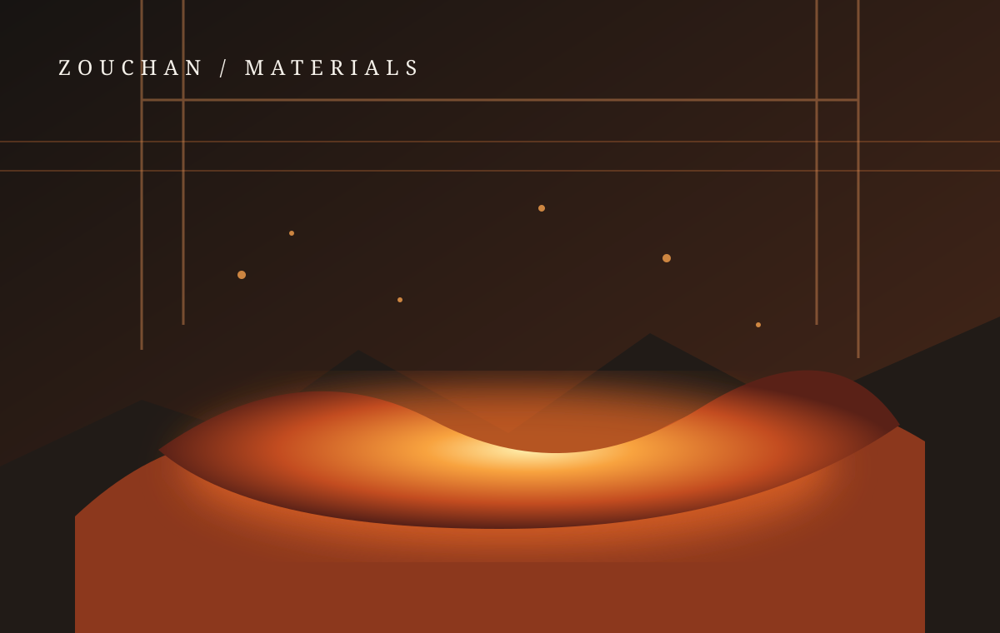
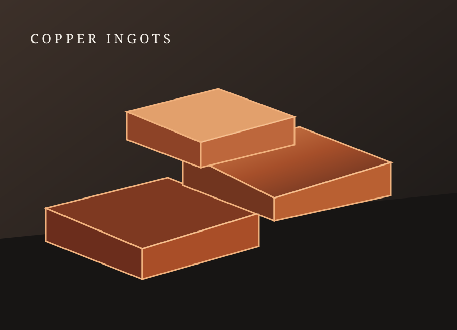

# Zouchan Copper — Professional Static Website

A responsive, Persian-first corporate website concept for **Zouchan (ZOUCHAN)**, focused on copper, copper products, and copper-alloy families. The project is built as a fully static website and can be published directly on GitHub Pages.

> **Content note:** This is a design and content framework, not a verified corporate profile. Company history, production capacity, certifications, contact details, plant location, and operational claims are intentionally not fabricated. News items, journal issues, and technical illustrations are clearly presented as samples or educational material.

## Features

- Premium industrial visual system using copper, bronze, charcoal, cream, and white.
- Responsive sticky navigation with an accessible mobile menu.
- Hero slider, smooth anchor navigation, and back-to-top control.
- Product catalogue with category filters and search.
- Product detail dialogs with general alloy chemistry, properties, and applications.
- Copper applications, alloy-family overview, and an eight-stage generic process explainer.
- Quality-control overview without unsupported certification claims.
- Six sample news cards with category filtering.
- Three sample digital journal issues and downloadable sample PDFs.
- Eight educational article summaries with reading dialogs.
- Sustainability topics, interactive image gallery, and eight FAQ entries.
- Contact form with browser-side validation; it does **not** send messages to a server.
- Custom local SVG illustrations, so the core visual assets work offline and do not depend on third-party image hosts.
- Custom 404 page and GitHub Pages-compatible relative paths.

## Products and alloy families

The catalogue introduces 23 items:

- **Copper and base products:** pure copper, copper cathode, copper ingot, copper billet, copper wire rod, copper sheet and strip.
- **Brass alloys:** common brass, cartridge brass, naval brass, leaded brass, aluminium brass, silicon brass.
- **Bronze alloys:** tin bronze, aluminium bronze, phosphor bronze, leaded bronze, manganese bronze, silicon bronze.
- **Special copper alloys:** cupronickel, beryllium copper, chromium copper, zirconium copper, copper-nickel alloys.

Chemical formulas are generic family descriptions. Exact percentages vary by grade and standard and must be confirmed against the relevant technical datasheet.

## Technology

- HTML5
- CSS3 (separate main and responsive stylesheets)
- Vanilla JavaScript (no framework, build step, server, or database)
- Local SVG illustrations and sample PDF documents

## Run locally

No package installation or build process is required. Open `index.html` in a browser, or serve the directory with any simple static-file server.

## Publish with GitHub Pages

1. Extract the ZIP archive.
2. Open the extracted project folder and select **all contents inside it** (not the parent folder itself).
3. Upload or commit those contents to the **root** of your GitHub repository. Confirm that `index.html` is directly at the repository root.
4. In GitHub, open **Settings → Pages**.
5. Under **Build and deployment**, choose **Deploy from a branch**.
6. Select your publishing branch (usually `main`) and folder `/ (root)`, then save.
7. Wait for the Pages deployment to finish. The published URL will be shown in the Pages settings.

All internal asset links are relative, so the site also works when published from a repository subpath.

## Visual preview





The `assets/images/` directory contains the local SVG illustrations used by the hero, catalogue, and gallery. They are deliberately editorial/diagrammatic placeholders, not documentary photographs of the Zouchan facility. Replace them with approved company photography when available, preserving descriptive `alt` text.

## Project structure

```text
zouchan-modern/
├── index.html
├── 404.html
├── style.css
├── responsive.css
├── script.js
├── README.md
└── assets/
    ├── images/
    └── journals/
        ├── zouchan-journal-sample-01.pdf
        ├── zouchan-journal-sample-02.pdf
        └── zouchan-journal-sample-03.pdf
```

## Before production use

- Replace sample illustrations with approved industrial photography.
- Confirm the official Persian and English legal brand name.
- Add verified company introduction, contact details, location, social profiles, and product datasheets.
- Replace sample news and journal content with reviewed editorial material.
- Connect the contact form to a trusted form service if message delivery is required.
- Have technical alloy descriptions reviewed against the exact standards and grades being offered.
